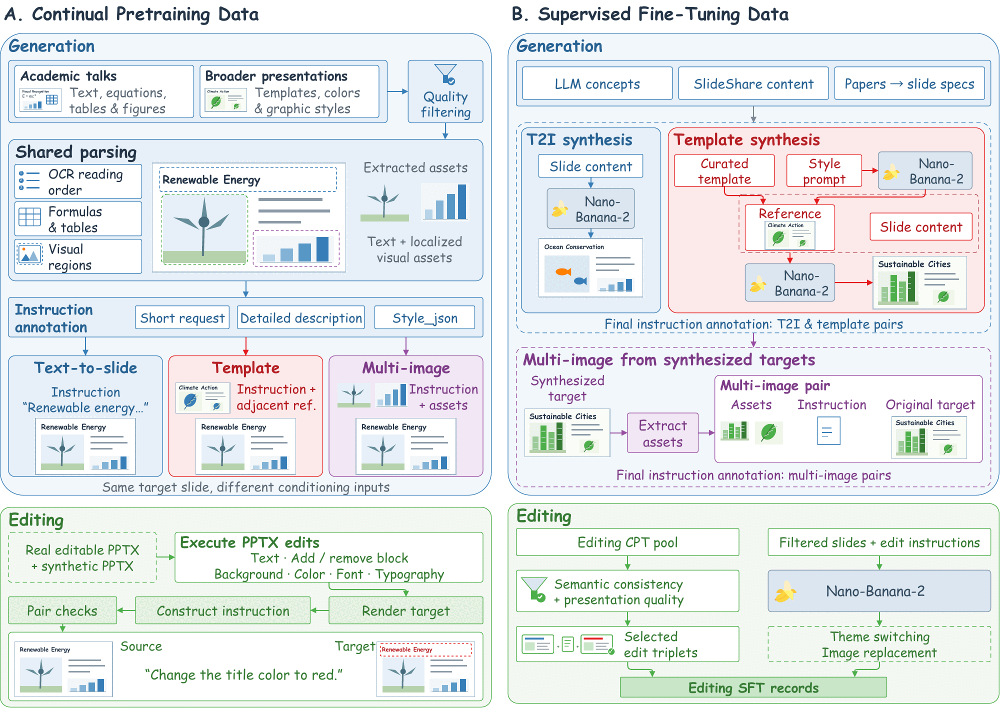
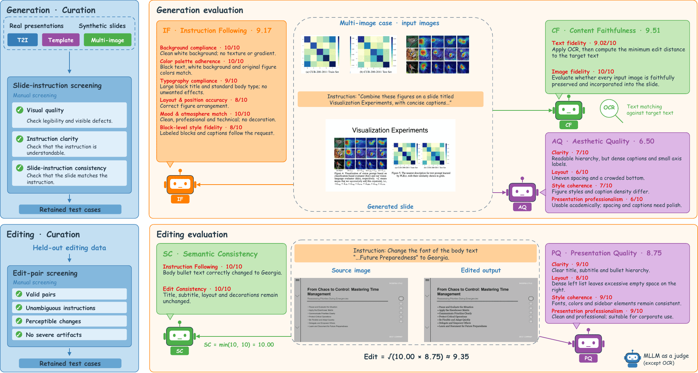

<h1 align="center">InfoVis: Unified Slide Image Generation and Editing</h1>

<p align="center">
  
  
  
  
</p>

<h4 align="center">
    <p>
        <a href=#-最新动态>最新动态</a> |
        <a href=#-简介>简介</a> |
        <a href=#-快速开始>快速开始</a> |
        <a href=#%EF%B8%8F-训练>训练</a> |
        <a href=#%EF%B8%8F-引用>引用</a>
    <p>
</h4>

<p align="center"><a href="README.md">English</a> | <b>简体中文</b></p>

**InfoVis** 是一个统一的 9B 幻灯片图像生成与编辑模型，一个模型同时支持四类任务：文生幻灯片、模板参考生成、多图约束生成和指令编辑。本仓库提供 InfoVis 的训练代码（继续预训练与监督微调）和推理代码。

## ✨ 亮点

- **一个模型覆盖四类幻灯片任务**：四类任务共用同一套“文本 + 图像”输入接口。输入图像可以是风格参考页、需要放进页面的素材，也可以是待编辑的原始页面。
- **面向幻灯片的数据引擎**：由真实演示文稿、可执行的 PPTX 编辑和合成幻灯片构建，包含 1300 万+ 条继续预训练数据和 190 万条监督微调数据。指令形式涵盖简短需求、详细描述和结构化的 `style_json`。
- **VisSlideBench**：1,527 条经过人工筛选的测试样本，覆盖全部四类任务，按任务设计了 11 项评测指标。自动评测给出的排序与盲评条件下逐维度的人工排序一致。
- **效果领先**：InfoVis 在 VisSlideBench 上总分 7.94（Nano-Banana-2 为 7.99），11 项指标全部领先所有参与评测的开源模型。在 BizGenEval Slides 上也是最好的开源模型；基于 InfoVis 的文档转幻灯片流程在 SlidesGen-Bench 美观度评测中位列十个系统中的第二。

## 🔥 最新动态

- **2026-10-09**：发布 InfoVis 的训练代码（继续预训练 + SFT）和推理代码。

## 📖 简介

幻灯片对图像生成模型要求很高：文字要渲染准确，各类元素要排成连贯的版面，给定的素材要如实放进页面，编辑时只改指定内容、不动其余部分。InfoVis 把幻灯片制作统一为“文本条件 + 可选输入图像”的条件生成问题：

| 任务 | 输入图像 | 指令 |
|---|---|---|
| 文生幻灯片 | 无 | 简短需求、详细描述或 `style_json` |
| 模板参考生成 | 一张参考页，决定视觉风格 | 同上三种形式 |
| 多图约束生成 | 1–4 张必须出现在页面中的素材 | 同上三种形式 |
| 幻灯片编辑 | 原始页面 | 自然语言编辑指令 |

**数据**：数据引擎把真实演示文稿解析成文本和带位置的视觉素材，再把每一页构造成文生幻灯片、模板参考和多图约束三类样本，三者共用原始页面作为目标。编辑数据来自实际执行的 PPTX 编辑；SFT 阶段另外加入了由模型生成的主题切换和图片替换样本。

<p align="center">
  
  <br>
  <em>幻灯片数据引擎：继续预训练数据（左）与监督微调数据（右）。</em>
</p>

**训练**：InfoVis 沿用 FLUX.2-klein-base-9B 的模型结构，把最大文本长度提升到 4,096 个 token，只训练扩散 Transformer，分三个阶段：

1. **幻灯片继续预训练**：在大规模文生幻灯片数据上训练。
2. **四任务混合继续预训练**：把幻灯片先验扩展到风格参考、多图约束和编辑。
3. **分任务 SFT 与模型融合**：先做一段共享的文生幻灯片 SFT，再从共享 checkpoint 出发分别训练四个任务的 SFT 分支，最后把四个分支线性融合成最终模型。

**VisSlideBench**：生成任务评测内容忠实度（CF，基于 OCR 的文字准确度；多图任务另外检查输入图像是否被如实保留）、指令遵循（IF）和美观度（AQ）；编辑任务评测语义一致性（SC）和呈现质量（PQ）。需要模型打分的维度使用 GPT-4.1 作为评委。

<p align="center">
  
  <br>
  <em>VisSlideBench 的样本筛选与评测流程。</em>
</p>

**VisSlideBench 主结果**：总分为 11 项指标的平均值，只对支持全部四类任务的模型给出。

| 模型 | T2I CF | T2I IF | T2I AQ | 模板 CF | 模板 IF | 模板 AQ | 多图 CF | 多图 IF | 多图 AQ | 编辑 SC | 编辑 PQ | 总分 |
|---|---:|---:|---:|---:|---:|---:|---:|---:|---:|---:|---:|---:|
| *闭源模型* | | | | | | | | | | | | |
| GPT-Image-2 | 8.52 | 8.57 | 7.71 | 8.19 | 8.51 | 7.62 | 8.93 | 8.44 | 7.61 | 9.80 | 8.04 | 8.36 |
| Nano-Banana-2 | 8.38 | 8.17 | 7.33 | 7.59 | 7.95 | 7.08 | 8.60 | 7.93 | 7.14 | 9.70 | 8.03 | 7.99 |
| Qwen-Image-2 | 7.18 | 6.89 | 6.38 | 8.23 | 6.29 | 5.74 | 6.97 | 6.25 | 5.55 | 4.96 | 6.47 | 6.45 |
| *开源模型* | | | | | | | | | | | | |
| FLUX.2-dev | 6.60 | 7.08 | 5.29 | 6.28 | 7.38 | 5.22 | 6.54 | 7.13 | 5.20 | 6.12 | 7.18 | 6.37 |
| FLUX.2-klein-base-9B | 6.29 | 7.11 | 5.19 | 6.44 | 7.24 | 5.40 | 6.57 | 6.99 | 5.32 | 5.98 | 6.72 | 6.30 |
| HiDream-O1-Image | 6.82 | 5.62 | 4.68 | 5.97 | 5.14 | 4.50 | 5.60 | 4.90 | 4.17 | 2.23 | 3.77 | 4.85 |
| BAGEL | 3.50 | 5.68 | 3.79 | 3.31 | 5.17 | 3.73 | 3.74 | 4.76 | 3.55 | 5.10 | 6.17 | 4.41 |
| OmniGen2 | 3.89 | 5.13 | 3.14 | 3.75 | 5.82 | 3.34 | 4.06 | 4.90 | 3.23 | 2.82 | 5.22 | 4.12 |
| **InfoVis（本文）** | **8.42** | **8.01** | **7.02** | **8.14** | **8.09** | **7.00** | **8.71** | **8.01** | **7.06** | **9.13** | **7.75** | **7.94** |

只支持部分任务的开源模型（Qwen-Image、Z-Image-Turbo、LongCat-Image、Qwen-Image-Edit、LongCat-Image-Edit）在论文中按各自支持的任务比较。

<p align="center">
  
  <br>
  <em>InfoVis 的幻灯片编辑示例（左：原图，右：编辑结果）。</em>
</p>

## 📌 TODO

- [x] 训练代码（继续预训练 + SFT）与推理代码。
- [ ] InfoVis 模型权重。
- [ ] VisSlideBench 及其评测代码。
- [ ] 训练数据。

## 🚀 快速开始

### 🛠️ 环境配置

```bash
# （可选）新建一个干净的 Python 环境
conda create -n infovis python=3.12
conda activate infovis

# 按 CUDA 版本安装 PyTorch（此处以 CUDA 12.6 为例）
pip install torch==2.7.1 torchvision --extra-index-url https://download.pytorch.org/whl/cu126

# 克隆本仓库并安装其余依赖
git clone https://github.com/VectorSpaceLab/InfoVis.git
cd InfoVis
pip install -r requirements.txt
```

<details>
<summary>🌏 中国大陆用户</summary>

```bash
# 从国内镜像安装 PyTorch
pip install torch==2.7.1 torchvision --index-url https://mirror.sjtu.edu.cn/pytorch-wheels/cu126

# 从 PyPI 镜像安装其余依赖
pip install -r requirements.txt -i https://pypi.tuna.tsinghua.edu.cn/simple
```
</details>

InfoVis 的所有模块都从 `diffusers` 和 `transformers` 加载；支持 FLUX.2-klein 需要 `diffusers>=0.37`。下载底模（需先在 Hugging Face 上同意其许可协议）：

```bash
huggingface-cli download black-forest-labs/FLUX.2-klein-base-9B
```

### 🧪 推理

`--transformer` 指向 InfoVis 的 transformer（diffusers 格式的目录）。输入图像按顺序传入：模板参考生成传参考页，多图约束生成传 1–4 张素材，编辑传原始页面。

```bash
# 文生幻灯片
python inference.py --transformer checkpoints/InfoVis \
  --prompt "A clean title slide for a talk on renewable energy, with a wind turbine illustration on the left." \
  --out t2i.png

# 模板参考生成
python inference.py --transformer checkpoints/InfoVis \
  --prompt "Follow the style of the reference slide and create a slide titled 'Quarterly Results' ..." \
  --images reference.png --out template.png

# 多图约束生成
python inference.py --transformer checkpoints/InfoVis \
  --prompt "Combine the two charts on a slide titled 'Experiment Results' with short captions." \
  --images chart1.png chart2.png --out multi_image.png

# 幻灯片编辑（输出尺寸与原图一致）
python inference.py --transformer checkpoints/InfoVis \
  --prompt "Change the title color to red." \
  --images source.png --width 1280 --height 720 --out edited.png
```

也可以在 Python 中直接调用：

```python
from inference import load_pipeline, generate, open_image

pipe = load_pipeline("black-forest-labs/FLUX.2-klein-base-9B", "checkpoints/InfoVis")
slide = generate(pipe, "Change the title color to red.", [open_image("source.png")], width=1280, height=720)
slide.save("edited.png")
```

采样设置：50 步 Euler 采样，classifier-free guidance 4.0（负向提示为空），文本上下文 4,096 个 token（更长的提示会被截断），BF16。默认输出尺寸为 1376x768。每张输入图像的面积上限为 1024x1024 像素，并居中裁剪为 32 的倍数。

### 📊 在 VisSlideBench 上运行 InfoVis

```bash
bash scripts/infer_visslidebench.sh checkpoints/InfoVis /path/to/VisSlideBench outputs/infovis
```

脚本每张 GPU 起一个进程，生成全部四个子任务，结果写到 `outputs/infovis/<track>/<id>.png`，随机种子为 `2233 + index`。文生幻灯片按 1280x720 生成；模板参考、多图约束和编辑按记录中的 `width` 和 `height` 生成。打分脚本随 VisSlideBench 一起发布。

## 🏋️ 训练

### 数据格式

训练 jsonl 的每一行是一条样本，图像路径相对于数据根目录：

```json
{"id": "sft/template/long/000000012", "task": "template",
 "instruction": "Match the attached slide's style ...",
 "input_images": ["images/sft/template/....png"],
 "output_image": "images/sft/....png",
 "target_img_size": [1376, 768]}
```

`configs/data/*.yaml` 列出了每个阶段使用的 jsonl 文件。设置好数据根目录后，先生成一次继续预训练阶段使用的回放子集：

```bash
export INFOVIS_DATA_ROOT=/path/to/InfoVis-Data
python tools/make_subsets.py --data_root $INFOVIS_DATA_ROOT
```

### 训练阶段

每个阶段都是对 transformer 的全参数训练：FSDP（hybrid sharding）、BF16、gradient checkpointing，优化器为 AdamW（学习率 5e-5，betas 0.9/0.95，weight decay 0.01，梯度裁剪 1.0），每张 GPU 一条样本、梯度累积 8 步。文本编码器（Qwen3）和 VAE 全程冻结。

| 配置 | 阶段 | 初始化自 | 节点数（每节点 8 卡） | Global batch | 步数 |
|---|---|---|---:|---:|---:|
| `01_cpt_t2i` | 阶段 1：文生幻灯片继续预训练 | FLUX.2-klein-base-9B | 6 | 384 | 13,500 |
| `02_cpt_mix_a` | 阶段 2：四任务混合继续预训练 | `01` 第 13,500 步 | 10 | 640 | 8,500 |
| `03_cpt_mix_b` | 阶段 2：四任务混合继续预训练 | `02` 第 8,500 步 | 10 | 640 | 6,000 |
| `04_cpt_mix_c` | 阶段 2：四任务混合继续预训练 | `03` 第 6,000 步 | 10 | 640 | 2,000 |
| `05_sft_t2i` | 阶段 3：文生幻灯片 SFT | `04` 第 2,000 步 | 10 | 640 | 4,500 |
| `06_sft_template` | 阶段 3：模板参考 SFT | `05` 第 1,500 步 | 10 | 640 | 1,500 |
| `07_sft_multi_image` | 阶段 3：多图约束 SFT | `05` 第 1,500 步 | 12 | 768 | 2,500 |
| `08_sft_edit` | 阶段 3：编辑 SFT | `05` 第 1,500 步 | 12 | 768 | 500 |

`05_sft_t2i` 的第 1,500 步是另外三个 SFT 分支共用的起点。在该阶段的所有节点上启动训练：

```bash
NNODES=10 NODE_RANK=$RANK MASTER_ADDR=$MASTER bash scripts/train.sh configs/train/02_cpt_mix_a.yaml
```

命令末尾可以追加 `key=value` 覆盖配置（例如 `train.max_steps=100`）。训练中断后重新启动会从最新的 checkpoint 继续。GPU 较少时，调大 `train.gradient_accumulation_steps`，保持 `train.global_batch_size` 不变。

### 导出与融合

每个 `checkpoint-N/` 目录下的 `pytorch_model_fsdp.bin` 是完整的 transformer 权重。把四个 SFT 分支导出后线性融合成最终模型：

```bash
python tools/export_transformer.py --checkpoint experiments/05_sft_t2i/checkpoint-4500/pytorch_model_fsdp.bin --output_dir checkpoints/sft_t2i
python tools/export_transformer.py --checkpoint experiments/06_sft_template/checkpoint-1500/pytorch_model_fsdp.bin --output_dir checkpoints/sft_template
python tools/export_transformer.py --checkpoint experiments/07_sft_multi_image/checkpoint-2500/pytorch_model_fsdp.bin --output_dir checkpoints/sft_multi_image
python tools/export_transformer.py --checkpoint experiments/08_sft_edit/checkpoint-500/pytorch_model_fsdp.bin --output_dir checkpoints/sft_edit

python tools/merge_checkpoints.py \
  --checkpoints checkpoints/sft_t2i checkpoints/sft_template checkpoints/sft_multi_image checkpoints/sft_edit \
  --coefficients $W_T2I $W_TEMPLATE $W_MULTI $W_EDIT --output_dir checkpoints/InfoVis
```

融合在 CPU 上进行，约需 100 GB 内存。

### 文本特征

Transformer 的文本输入是 Qwen3 三层特征在特征维上的拼接，`text_layer_offset` 决定取哪三层：`1` 取第 9、18、27 个 decoder layer 的输出，所有训练阶段都用的这种；`0` 取 `hidden_states[9, 18, 27]`，即 FLUX.2-klein pipeline 的取法，论文评测用的是这种。训练配置默认 `1`，`inference.py` 默认 `0`。两种取法只差一个残差块，在训练样本上，发布模型在两种取法下的 flow matching loss 相同（差异在 0.1% 以内）。

## 📂 仓库结构

```
train.py                     所有阶段共用的训练脚本
inference.py                 单条推理与 VisSlideBench 批量推理
infovis/modeling.py          模型加载、Qwen3 文本特征、VAE latent
infovis/flow_matching.py     rectified flow 训练目标与时间步采样
infovis/data.py              jsonl 数据集、collator、按分辨率分桶的 sampler
tools/export_transformer.py  训练 checkpoint → diffusers 格式的 transformer
tools/merge_checkpoints.py   四个 SFT 分支的线性融合
tools/make_subsets.py        根据发布的 id 列表生成 CPT 回放子集
configs/train/               8 个训练阶段的配置
configs/data/                各阶段的数据配比
configs/accelerate_fsdp.yaml FSDP 配置
scripts/train.sh             多机训练启动脚本
scripts/infer_visslidebench.sh  8 卡 VisSlideBench 推理脚本
```

## 📜 许可证

InfoVis 由 FLUX.2-klein-base-9B 微调得到，模型权重属于 FLUX 模型的衍生模型，按 [FLUX Non-Commercial License](https://huggingface.co/black-forest-labs/FLUX.2-klein-base-9B) 发布，仅限非商业用途。

## 🙏 致谢

InfoVis 基于 [FLUX.2-klein](https://huggingface.co/black-forest-labs/FLUX.2-klein-base-9B) 和 [diffusers](https://github.com/huggingface/diffusers) 构建。训练框架最初来自 [OmniGen2](https://github.com/VectorSpaceLab/OmniGen2)，VisSlideBench 的人工验证沿用了 [EditScore](https://github.com/VectorSpaceLab/EditScore) 的标注协议。

## ❤️ 引用

如果本仓库或我们的工作对你有帮助，欢迎点个 star ⭐ 并引用 🦖：

```bibtex
@misc{infovis2026,
  title  = {InfoVis: Unified Slide Image Generation and Editing},
  year   = {2026}
}
```
